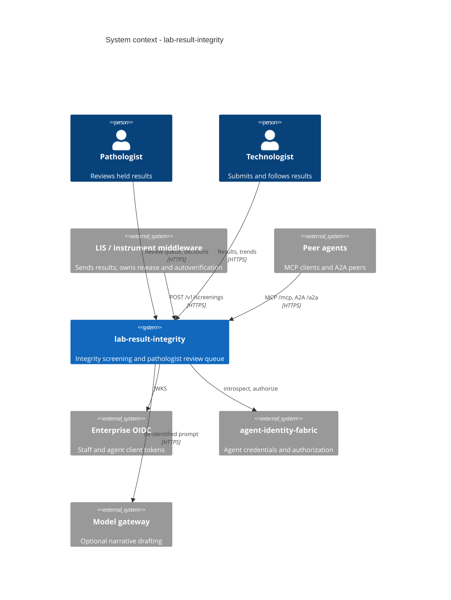
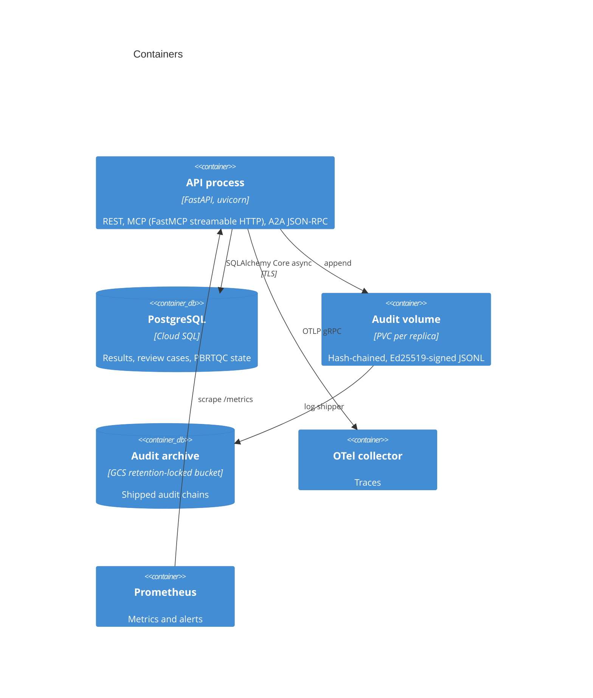
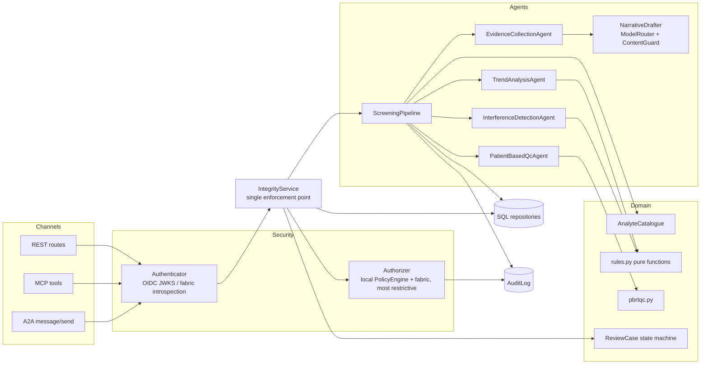
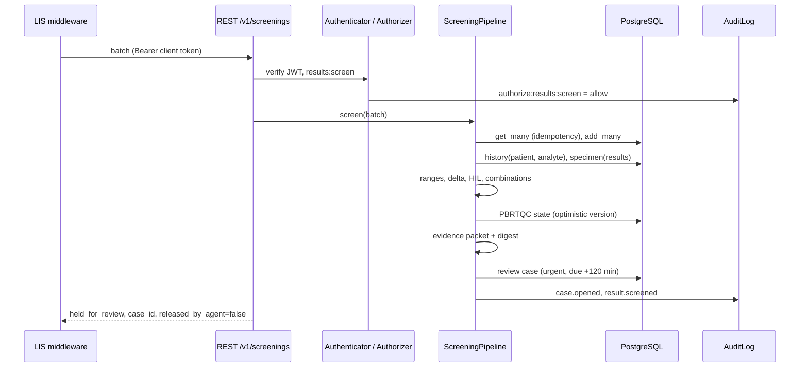
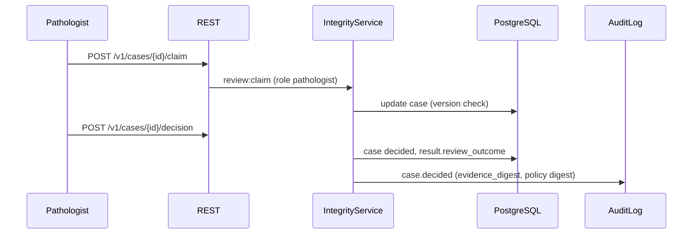
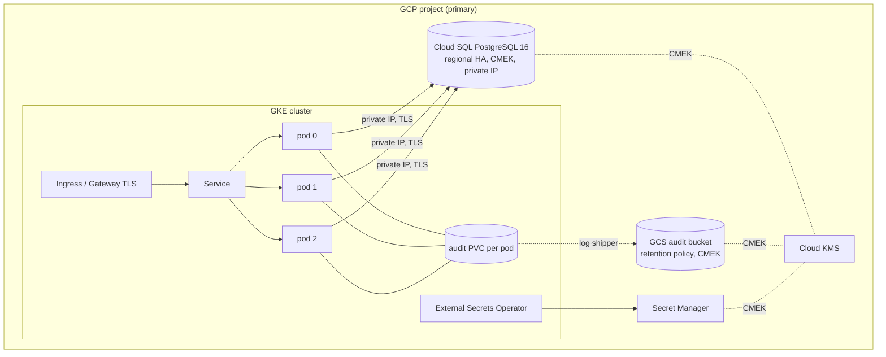

# Architecture overview

## Business problem

A clinical laboratory releases thousands of numeric results a day. Most are
released by autoverification rules in the LIS; the rest wait for a
technologist or pathologist. The errors that matter most are not analytical
outliers but integrity failures: a specimen from the wrong patient, a
hemolysed potassium, K2EDTA carry-over, a sample drawn above a dextrose drip,
an analyzer drifting between QC runs. Each is detectable from data the
laboratory already has (prior results, serum indices, the other analytes in
the same tube, the stream of patient results per instrument), but the checks
are spread across middleware, LIS rules and individual vigilance, and the
evidence behind a hold is rarely assembled in one place.

`lab-result-integrity` runs those checks as a set of cooperating agents,
assembles an evidence packet for every held result, and queues it for a
pathologist. It never releases, verifies or autoverifies a result. Release
stays with the laboratory's validated LIS rules or a human.

## Flow

```
Results ─▶ Trend Analysis ─▶ Interference Detection ─▶ Patient-based QC
        ─▶ Evidence Collection ─▶ Pathologist Review queue ─▶ Decision (human)
```

| Stage | Agent | What it does |
|---|---|---|
| Results | screening orchestrator | Validates, de-duplicates (content digest), persists the batch, orders by collection time |
| Trend analysis | `trend-analysis` | Delta check against the most recent prior result inside the analyte's window (absolute and/or percent, `any`/`all`), least-squares trend over the trend window |
| Interference detection | `interference-detection` | HIL index rules per analyte (flag or withhold), implausible combinations across the specimen's results, plausibility limits |
| Patient-based QC | `patient-based-qc` | SMA or EWMA of truncated patient results per instrument and analyte; alarm, look-back list, recovery |
| Ranges | (part of screening) | Reference interval by age band and sex; critical limits; unknown sex uses the narrowest combined interval |
| Evidence collection | `evidence-collection` | Packet with result, priors, findings with citations, specimen results, QC snapshot, catalogue digest, provenance; optional de-identified narrative; SHA-256 digest |
| Review | pathologist (human) | Claim, decide (`confirm`, `confirm_with_comment`, `request_recollection`, `cancel_result`); decision bound to the evidence digest |

Findings at `warning` severity or above hold a result. `critical` findings
make the case `stat`, `high` makes it `urgent`, `warning` makes it `routine`.
SLA minutes per priority come from the catalogue's `review_policy`.

## C4: system context



## C4: containers



## C4: components



## Sequence: screening a hemolysed potassium



## Sequence: pathologist decision



## MCP integration

The MCP server uses the official `mcp` SDK (`FastMCP`, stateless streamable
HTTP, JSON responses) mounted at `/mcp`. An ASGI wrapper authenticates every
request before it reaches the session manager; the principal is carried in
the ASGI scope. Tools: `screen_results`, `get_result`, `patient_trend`,
`review_queue`, `get_case`, `propose_disposition`, `pbrtqc_status`. Each has
typed input and output schemas generated from the Pydantic models, is
authorized by the application service and is written to the audit chain as
`mcp.<tool>`. There is no tool that claims, decides, releases or verifies.
DNS-rebinding protection allows only the configured public host.

## A2A communication

`GET /.well-known/agent-card.json` publishes the Agent Card (protocol 0.3.0:
name, description, url, version, capabilities, skills, securitySchemes,
security). `POST /a2a` accepts JSON-RPC 2.0 `message/send`; the first `data`
part names a skill (`screen-results`, `review-queue`, `get-case`,
`propose-disposition`) and carries its input. The call routes to the same
application service as REST, returns a completed `Task` with a data
artifact, and maps domain errors to server-defined JSON-RPC codes
(-32040 forbidden, -32041 not found, -32042 conflict, -32043 upstream).

## Identity and authorization

See [agent-specification.md](agent-specification.md#permissions) and
[ADR 0002](adr/0002-local-policy-combined-with-fabric.md). Every action is
evaluated by the local policy; fabric credentials are also authorized by
agent-identity-fabric and the most restrictive outcome wins. At start-up the
service evaluates its own policy against a fully scoped synthetic agent and
refuses to run if any of `result:release`, `result:autoverify`,
`result:verify`, `review:claim`, `review:decide` or `review:override` would
not be denied.

## Observability

- Metrics (`/metrics`, own registry): request latency by route, results
  screened by disposition, findings by kind and severity, cases opened by
  priority, decisions by outcome, overdue cases, escalations, PBRTQC alarms,
  authorization decisions, narrative outcomes, MCP calls, A2A requests.
- Alerts in [configs/prometheus/alerts.yaml](../../configs/prometheus/alerts.yaml);
  dashboard in [configs/grafana/lab-result-integrity.json](../../configs/grafana/lab-result-integrity.json).
- Traces: OpenTelemetry FastAPI instrumentation, OTLP gRPC exporter.
- Logs: JSON via agentic-core, correlation ID from `X-Correlation-ID`,
  sensitive keys scrubbed.

## CI/CD

`ci.yml`: quality on Python 3.12 and 3.13 (ruff, black, mypy strict, bandit,
contract drift, all test suites with a 90% coverage gate), PostgreSQL
integration, deploy artifacts (helm lint and render, required-values failure
check, kubeconform, terraform fmt/validate on three clouds, Trivy config scan),
container (build, smoke test, production-refusal check, Trivy image, Syft SBOM,
Grype), Semgrep. `release.yml` on `v*.*.*` tags: quality gate, version check,
image to GHCR with SBOM and provenance attestation, Helm chart to GHCR OCI,
GitHub release with SBOM.

## Deployment



GKE Workload Identity binds the Kubernetes service account to a Google
service account that may only create objects in the audit bucket. Terraform
for GCP, AWS (RDS, Secrets Manager, S3 Object Lock, IRSA) and Azure
(PostgreSQL Flexible Server, Key Vault, immutable Blob, Workload ID) lives in
`deployments/terraform/`.

## Cost and scalability

- Compute: the hot path is CPU-light (rule evaluation under 2 ms per result
  in the performance suite); a batch costs a handful of indexed queries plus
  one PBRTQC state update per result. Three replicas at 250m/384Mi handle
  typical laboratory volumes; the HPA scales on CPU.
- Database: the dominant cost. Results are indexed by
  (patient, analyte, collected_at) and specimen; cases by
  (status, priority, due_at). Partition `results` by month when the table
  passes roughly 100 million rows.
- PBRTQC state is one row per instrument and analyte with optimistic
  concurrency, so replicas can screen in parallel; contention is retried and
  surfaces as a 409 for the batch rather than double counting.
- Narratives are optional. When enabled they add one model call per held
  result only (not per screened result), routed to the cheapest approved
  provider through the model gateway.

## Acceptance criteria

1. No REST route, MCP tool or A2A skill can release, verify or autoverify a
   result; every outcome carries `released_by_agent: false` (tests:
   `tests/security/test_attacks.py`, `tests/e2e`).
2. The service refuses to start in production with a starter catalogue, and
   under any policy that would let an agent release or decide (CI smoke test,
   `tests/unit/test_container.py`).
3. Delta, range, critical, HIL, combination and PBRTQC rules fire exactly as
   configured (`tests/unit/test_rules.py`, `test_pbrtqc.py`, property tests).
4. Every held result has a case with an evidence packet, digest and cited
   sources; decisions record the evidence digest and the policy digest.
5. Re-submitting identical results is idempotent; changed content conflicts;
   an interrupted screening resumes without duplicating cases or QC counts.
6. Agent proposals are recorded as `pending_human_approval` and never change
   case state.
7. Coverage at least 90% across unit, integration, security, chaos,
   performance and e2e suites; every CI job green.
